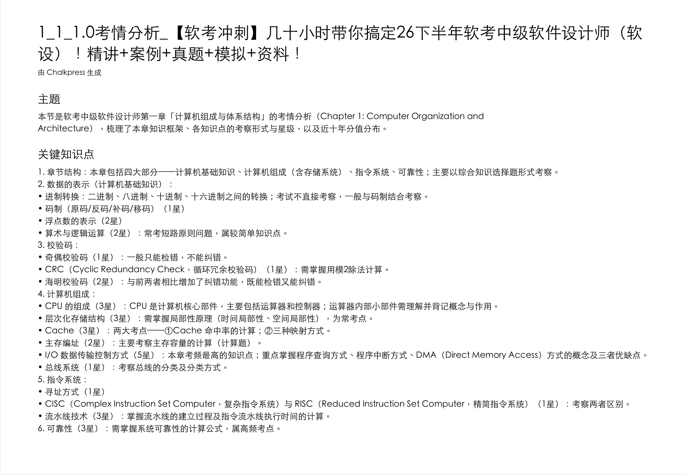
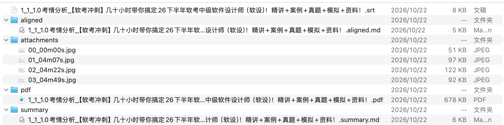

<div align="center">

# Chalkpress

**Turn lecture videos into searchable, printable PDF handouts**

**A 30-minute lecture → a 5-minute read**: AI summary first for the framework, keyframe pages instead of scrubbing, review by search instead of re-watching

🎬 Video ──→ 📄 Handout · Keyframe pages · Aligned subtitles · AI summary · Fully local

[](https://github.com/luolin1024/chalkpress/releases)
[](#download)
[](https://github.com/luolin1024/chalkpress/stargazers)

**[Download](https://github.com/luolin1024/chalkpress/releases)** · [中文文档](./README.md)

</div>

---

## Two ways through one lecture: 30 minutes watched vs 5 minutes read

The worst part of watching lectures isn't watching — it's **finding things again**. Video isn't searchable, can't be printed, and scrubbing relies on memory. Chalkpress compresses a lecture into a **handout booklet** you can skim, search, and print:

| Scenario | Watching | Reading the handout |
|------|--------|--------|
| Grasping the key points | 30 minutes of linear playback | **~5 minutes**: AI summary page 1 for the framework, then flip keyframe pages for detail |
| Finding a specific topic | Scrub back and forth from memory | Full-text search lands on the exact page in seconds |
| Revisiting weak sections | Re-watch nearly everything | Only those pages; timestamps on every page take you back to that 1–2 minutes of video |
| Print & annotate on paper | Impossible | One knowledge slide per page, print and carry |

Where the time savings come from:

1. **AI summary on page 1** — structured key points with star weights; 30 seconds to decide what deserves a closer look
2. **Keyframes as pages** — a page only when content changes: a 30-minute slide lecture typically yields 30–40 pages, each pairing the visual with the narration text
3. **Searchable + timestamped** — real text layer, fully searchable; every page shows its time window, so "review" becomes lookup, not re-watching

> The handout doesn't replace watching — it decouples "getting through it" from "retaining / finding it": reading for coverage, timestamps for re-watching.

**The pipeline** (transcription & extraction run fully local):

- **Keyframes as pages** — scene-detection-driven extraction (cuts when content changes, not fixed intervals)
- **Subtitles on page** — local Whisper transcription, aligned to the time window of each frame
- **AI study notes** — optional: any OpenAI-compatible vision model generates structured notes as page 1
- **Fully local** — transcription & extraction never leave your machine; LLM is the only optional outbound call
- **Zero-config** — drag a video in, hit start, everything else is automatic

**Output per video**: `handout.pdf` (searchable text layer) · `subtitles.srt` · `aligned.md` · `summary.md`

## ✨ Output preview

**AI study notes (page 1)** — auto-extracted exam-point structure with star weights from a real lecture:



**Output folder** — one conversion, a complete handout kit:



## Install

Grab a build from [GitHub Releases](https://github.com/luolin1024/chalkpress/releases):

| Platform | File |
|---|---|
| Windows | `Chalkpress_*_x64-setup.exe` |
| macOS (Apple Silicon) | `Chalkpress_*_aarch64.dmg` |
| Linux x64 | `Chalkpress_*_amd64.AppImage` |

In-app auto-update included.

## Quick start

1. Drag a video (or a whole course folder) into the window
2. Hit **Start**
3. Open the output folder — your handout PDF sits next to the video

## CLI

```bash
chalkpress lecture.mp4                       # full pipeline
chalkpress course_dir/                       # batch: recursively expand
chalkpress lecture.mp4 --reuse-srt sub.srt   # skip transcription
chalkpress lecture.mp4 --speed turbo         # max transcription parallelism
```

## Privacy

- Videos and transcripts are processed **100% locally, never uploaded**
- The app collects anonymous usage statistics (conversion counts, feature usage, crash reports) to improve the product — **consent is asked on first launch, can be declined, and declining affects nothing**
- Your video content, transcript text, or personal information is never collected

## FAQ

<details>
<summary><b>Is "30 minutes → 5 minutes" exaggerated?</b></summary>

For slide-based lectures (PPT recordings, concept explanations) — the typical case — page count ≈ slide count, so skimming the summary + flipping pages really compresses a 30-minute pass to ~5 minutes. Dense, derivation-heavy content compresses less — but the handout still hands you the map first, so you spend time only where it matters.
</details>

<details>
<summary><b>Does it require an AI key?</b></summary>

No. Without an LLM you still get the keyframe PDF + subtitles. Configuring one enables subtitle proofreading and AI study notes.
</details>

<details>
<summary><b>English lectures?</b></summary>

Yes — Whisper auto-detects 90+ languages. `--summary-lang zh-en` produces bilingual notes.
</details>

<details>
<summary><b>Privacy?</b></summary>

Videos never leave your machine. Only if you configure an LLM will subtitle text and keyframes be sent to the endpoint YOU configured.
</details>

## License

- **Free forever for personal / educational use** (all features, no limits)
- **We collect anonymous usage statistics** to improve the product (consent asked on first launch; decline anytime — declining does not affect functionality); no video content, transcripts, or personal data is ever collected
- **Commercial use (training orgs / enterprises) requires a commercial license**: 2493468168@qq.com
- Personal / educational / non-commercial license: [PolyForm Noncommercial 1.0.0](./LICENSE)

---

<div align="center">

**Found it useful? Give it a ⭐**

</div>
