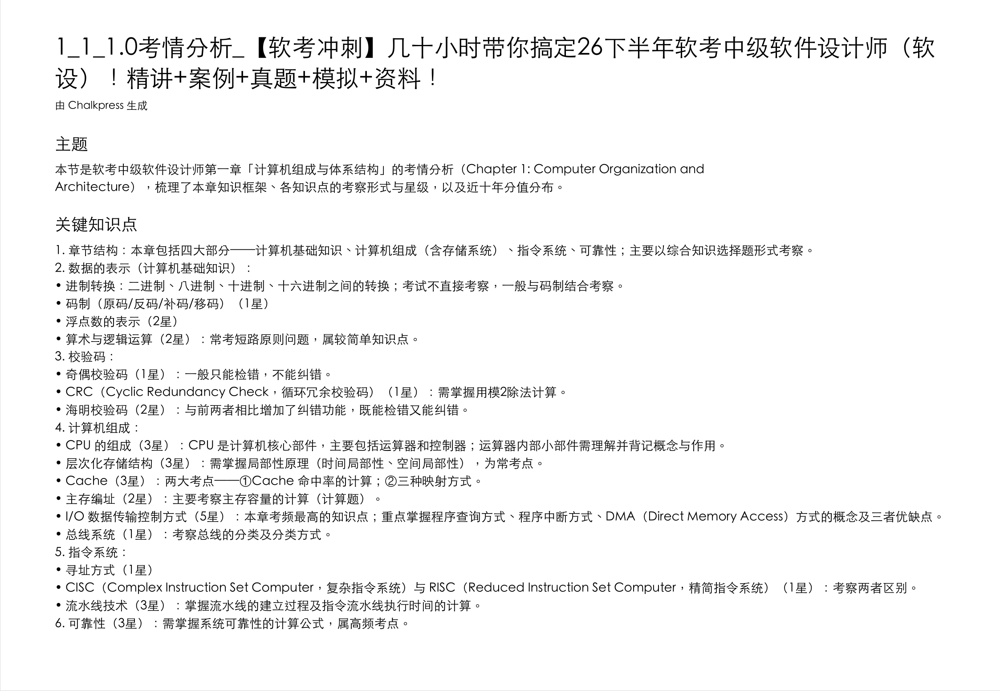
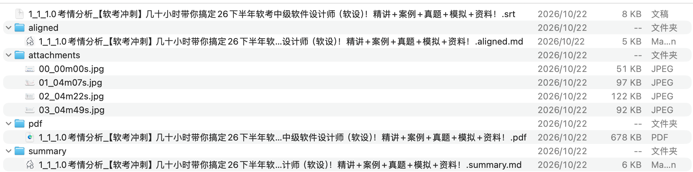

<div align="center">

# Chalkpress

**Turn lecture videos into searchable, printable PDF handouts**

🎬 Video ──→ 📄 Handout · Keyframe pages · Aligned subtitles · AI summary · Fully local

[](https://github.com/luolin1024/chalkpress/releases)
[](#download)
[](https://github.com/luolin1024/chalkpress/stargazers)

**[Download](https://github.com/luolin1024/chalkpress/releases)** · [中文文档](./README.md)

</div>

---

## What is this

The worst part of watching lectures isn't watching — it's **finding things again**. Video isn't searchable, can't be printed, and scrubbing relies on memory.

Chalkpress compresses a lecture into a **handout booklet**:

- **Keyframes as pages** — scene-detection-driven extraction (cuts when content changes, not fixed intervals)
- **Subtitles on page** — local Whisper transcription, aligned to the time window of each frame
- **AI study notes** — optional: any OpenAI-compatible vision model generates structured notes as page 1
- **Fully local** — transcription & extraction never leave your machine; LLM is the only optional outbound call
- **Zero-config** — drag a video in, hit start, everything else is automatic

**Output per video**: `handout.pdf` (searchable text layer) · `subtitles.srt` · `aligned.md` · `summary.md`

## ✨ Output preview

**AI study notes (page 1)** — auto-extracted exam-point structure with star weights from a real lecture:



**Output folder** — one conversion, a complete handout kit:



## Install

Grab a build from [GitHub Releases](https://github.com/luolin1024/chalkpress/releases):

| Platform | File |
|---|---|
| Windows | `Chalkpress_*_x64-setup.exe` |
| macOS (Apple Silicon) | `Chalkpress_*_aarch64.dmg` |
| Linux x64 | `Chalkpress_*_amd64.AppImage` |

In-app auto-update included.

## Quick start

1. Drag a video (or a whole course folder) into the window
2. Hit **Start**
3. Open the output folder — your handout PDF sits next to the video

## CLI

```bash
chalkpress lecture.mp4                       # full pipeline
chalkpress course_dir/                       # batch: recursively expand
chalkpress lecture.mp4 --reuse-srt sub.srt   # skip transcription
chalkpress lecture.mp4 --speed turbo         # max transcription parallelism
```

## FAQ

<details>
<summary><b>Does it require an AI key?</b></summary>

No. Without an LLM you still get the keyframe PDF + subtitles. Configuring one enables subtitle proofreading and AI study notes.
</details>

<details>
<summary><b>English lectures?</b></summary>

Yes — Whisper auto-detects 90+ languages. `--summary-lang zh-en` produces bilingual notes.
</details>

<details>
<summary><b>Privacy?</b></summary>

Videos never leave your machine. Only if you configure an LLM will subtitle text and keyframes be sent to the endpoint YOU configured.
</details>

## License

Free for personal / educational / non-commercial use ([PolyForm Noncommercial 1.0.0](./LICENSE)).
Commercial licensing (training orgs, enterprise): 2493468168@qq.com

---

<div align="center">

**Found it useful? Give it a ⭐**

</div>
