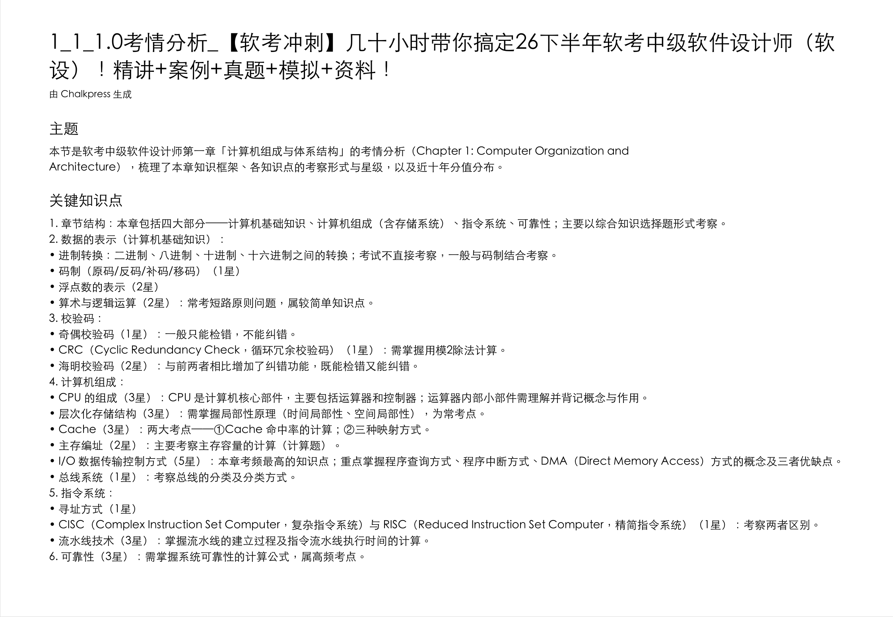
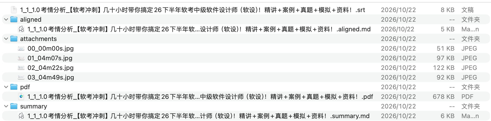

<div align="center">

# Chalkpress

**把讲座视频变成一册可检索、可打印的讲义 PDF**

**30 分钟的课 → 5 分钟读完**：AI 总结先给框架，关键帧成页代替拖进度条，复习靠搜索不靠重看

🎬 视频 ──→ 📄 讲义 · 关键帧成页 · 字幕随页 · AI 总结开篇 · 全程本地

[](https://github.com/luolin1024/chalkpress/releases)
[](#下载安装)
[](#许可与商业授权)
[](https://github.com/luolin1024/chalkpress/stargazers)

**[下载最新版](https://github.com/luolin1024/chalkpress/releases)** · [快速上手](#快速上手) · [CLI 用法](#cli) · [常见问题](#常见问题) · [English](./README.en.md)

</div>

---

## 一节课，两种过法：30 分钟看完 vs 5 分钟读完

看网课最痛的不是"看"，是**回头找**：视频没法检索、没法打印、拖进度条全靠记忆。Chalkpress 把一场讲座**压缩成一册讲义**——阅读从此可以跳读、搜读、打印读：

| 场景 | 看视频 | 读讲义 |
|------|--------|--------|
| 第一次抓重点 | 30 分钟线性播放，重点在哪只能等 | **约 5 分钟**：先读首页 AI 总结拿框架，再翻关键帧页补细节 |
| 复习找某个知识点 | 拖进度条靠记忆，来回试 | 关键词全文检索，**秒级定位到页** |
| 只想补薄弱的几段 | 几乎只能重看整节 | 只翻对应几页；需要听语气细节，按页内时间戳回看原视频那 1~2 分钟 |
| 打印批注 / 纸质复习 | 不可能 | 一页一个知识画面，直接打印随身复习 |

省时间靠的是三条机制：

1. **AI 总结开篇** —— 首页就是结构化要点（带星级权重），30 秒判断这节课讲什么、哪里值得细看
2. **关键帧成页** —— 内容变化才截页：30 分钟课件型课程通常只出 30~40 页，画面 + 讲解原文同页，翻页扫读代替线性播放
3. **可检索 + 时间戳** —— 文字层全文可搜可复制；每页标注时间窗，复习是"查"不是"看"

> 讲义不是替代看课，而是把「看完」和「记住 / 找到」解耦：通读交给阅读，回看交给时间戳。

处理管线（转写与抽帧全程本地）：

```
🎬 视频 ──→ ① 语音转写（Whisper 本地）──→ ② 字幕校对（可选 LLM）
        ──→ ③ 关键帧抽取（场景检测）──→ ④ 字幕×关键帧对齐
        ──→ ⑤ AI 学习笔记（可选）──→ 📄 讲义 PDF
```

| 你得到 | 说明 |
|--------|------|
| `讲义.pdf` | 首页 AI 总结 + 每页一个关键帧画面 + 该时间窗的字幕，**文字层可检索可复制** |
| `字幕.srt` | 全片字幕，可独立导入播放器 |
| `aligned.md` | 字幕×关键帧对照表（Markdown） |
| `summary.md` | AI 结构化学习笔记（配置 LLM 后） |

## 效果

**AI 学习笔记首页** —— 软考软设课程「考情分析」一节，自动提炼出带星级权重的考点结构：



**输出目录** —— 一次转换，交付完整讲义工程（字幕 / 对齐文档 / 关键帧 / PDF / AI 总结）：



<details>
<summary>应用截图</summary>


</details>

## 30 秒上手

1. [下载安装包](https://github.com/luolin1024/chalkpress/releases)（Windows / macOS / Linux）
2. 把视频拖进窗口，点 **开始转换**
3. 完成后点 **打开输出文件夹** —— 讲义 PDF 就在视频旁边

零配置：语音语言自动识别、字幕模型自动选择、输出语言默认简体中文。AI 总结是可选项，不配置也能用（关键帧 PDF + 字幕照常生成）；想开就在设置页填三行（接口地址 / Key / 模型名），任意 OpenAI 兼容端点均可。

## 特性

| | 特性 | 说明 |
|---|------|------|
| 🎯 | **关键帧成页** | 场景检测驱动抽帧：内容变化才截，不是机械等间隔 |
| 📝 | **字幕随页** | Whisper 本地转写，字幕对齐到所在画面的时间窗，页面即上下文 |
| 🤖 | **AI 总结开篇** | 接任意 OpenAI 兼容视觉模型，生成结构化学习笔记作为 PDF 首页 |
| 🔒 | **全程本地** | 转写、抽帧在你电脑上完成，视频不上传；LLM 是唯一可选的外呼 |
| 📚 | **场景术语自适应** | 识别课程领域，易听错的专业术语按领域缓存复用（软考证被听成软靠正？修掉） |
| ⏸️ | **暂停与断点续跑** | 阶段边界可暂停，已完成部分自动保存 |
| 🖥️ | **双形态** | 桌面 GUI（拖入即转）+ CLI（脚本/批量/管道） |

## 与常见工具的区别

| | Chalkpress | 剪映 / 飞书妙记 | 通用转写工具 |
|---|-----------|---------------|-------------|
| 产出形态 | **讲义 PDF**（画面+字幕同页） | 转文字稿 | 纯文字 |
| 可打印可检索 | ✅ 文字层 PDF | ❌ | ❌ |
| AI 结构化总结 | ✅ | ❌ | ❌ |
| 复习方式 | 搜关键词定位到页，按页回看 | 在长文字稿里翻找 | 翻找 |
| 视频上传 | **永不上传** | 需上传云端 | 视本地实现 |
| 批量整目录 | ✅ | ❌ | 视工具 |

## 隐私承诺

- 视频与转写内容**全程本地处理，永不上传**
- 应用收集匿名的使用统计（转换次数、功能使用、崩溃报告）以改进产品——**首次启动时征得同意，可拒绝，拒绝不影响任何功能**
- 不会收集你的视频内容、文字内容或个人信息

## 下载安装

从 [GitHub Releases](https://github.com/luolin1024/chalkpress/releases) 下载：

| 平台 | 文件 | 说明 |
|---|---|---|
| Windows | `Chalkpress_*_x64-setup.exe` | NSIS 安装向导（简中），per-user 无需管理员 |
| macOS (Apple Silicon) | `Chalkpress_*_aarch64.dmg` | 打开拖入 Applications |
| Linux x64 | `Chalkpress_*_amd64.AppImage` | 赋予执行权限后直接运行 |

应用内置**自动更新**（应用内静默更新）。

## CLI

```bash
chalkpress 视频.mp4                       # 全流程
chalkpress 目录/                          # 批量：递归展开目录
chalkpress 视频.mp4 --reuse-srt 已有.srt   # 已有字幕时跳过转写
chalkpress 视频.mp4 --summary-lang zh-en  # 中英对照总结
chalkpress 视频.mp4 --speed turbo         # 转写并发：standard/fast/turbo
chalkpress 视频.mp4 --layout grouped      # 分类输出：markdown/ pdf/ attachments/
chalkpress 视频.mp4 --zh-script traditional  # 繁体输出
```

## 常见问题

<details>
<summary><b>转写速度多快？</b></summary>

CPU int8 下约实时速度的 2-4 倍（视视频时长与语速）；macOS Apple 芯片自动启用 mlx-whisper GPU 加速，更快。`--speed turbo` 用满全部核心。
</details>

<details>
<summary><b>"30 分钟 → 5 分钟"夸张吗？</b></summary>

以**课件型网课**（PPT 录播、概念讲解为主）为典型场景：讲义页数 ≈ 课件页数，翻页扫读 + 首页总结确实能把"通览一节课"从 30 分钟压到 5 分钟上下。课程密度高、需要跟老师一步步推导的内容，压缩比会低一些——但讲义依然先给你地图，让你把时间只花在值得的段落，而不是平均用力。
</details>

<details>
<summary><b>必须配置 AI 吗？</b></summary>

不必须。不配置 LLM 也能产出「关键帧 PDF + 全片字幕」；配置后才启用字幕校对和 AI 学习笔记。
</details>

<details>
<summary><b>支持英文视频吗？</b></summary>

支持。Whisper 支持 90+ 语种自动识别；`--summary-lang zh-en` 可输出中英对照笔记。
</details>

<details>
<summary><b>我的视频可以上传吗/隐私？</b></summary>

视频**始终不上传**——转写和抽帧全程本地。只有你主动配置 LLM 时，字幕文本与关键帧会发送给你自己配置的模型端点。匿名使用统计在首次启动时单独征求同意，可拒绝。
</details>

<details>
<summary><b>和剪映/飞书妙记有什么区别？</b></summary>

它们做"转文字"，Chalkpress 做"**讲义**"：关键帧成页（画面+对应字幕在同一页）、可打印可检索的 PDF、AI 结构化总结，且全程本地、批量处理整个课程目录。
</details>

## 技术要点

- **流水线**：`Options → run()/run_batch()` 五段处理链，单个视频失败不中断批量
- **桌面 GUI**：Tauri 2（Svelte），Python 流水线以 PyInstaller sidecar 内嵌
- **本地 ASR**：faster-whisper（CPU int8 全平台）+ mlx-whisper（macOS GPU 加速）
- **可检索 PDF**：reportlab，帧为图、字幕/总结为真实文本层；CJK 字体三平台解析链不缺字
- **配置链**：显式参数 > `CHALKPRESS_*` 环境变量 > config.toml > 内置默认

## 从源码运行

```bash
# CLI（Python ≥ 3.9）
uv pip install -e .
chalkpress 视频.mp4

# GUI（Tauri 2 + Svelte）
corepack pnpm i
corepack pnpm tauri dev     # 开发
corepack pnpm tauri build   # 打包
```

## 路线图

- [x] 桌面 GUI（拖入即转 + 任务看板 + 设置中心）
- [x] 批量/课程目录递归处理
- [x] 三平台安装包 + 应用内自动更新
- [x] 场景术语自适应缓存
- [x] 应用内反馈通道
- [ ] 多语种界面语言包
- [ ] 云端批量 API（机构版）

## 许可与商业授权

**个人与教育用途永久免费**（含全部功能，无功能墙）：[PolyForm Noncommercial 1.0.0](./LICENSE)。

匿名使用统计仅用于改进产品，首次启动时征得同意、可随时拒绝；**拒绝与否不影响任何功能**。

**闭源 / 商业使用**（培训机构、企业内训等）需获得商业许可：[2493468168@qq.com](mailto:2493468168@qq.com)。

---

<div align="center">

**觉得有用？给个 ⭐ 让更多人看到**

[下载](https://github.com/luolin1024/chalkpress/releases) · [问题反馈](https://github.com/luolin1024/chalkpress/issues) · [商业授权洽谈](mailto:2493468168@qq.com)

</div>
